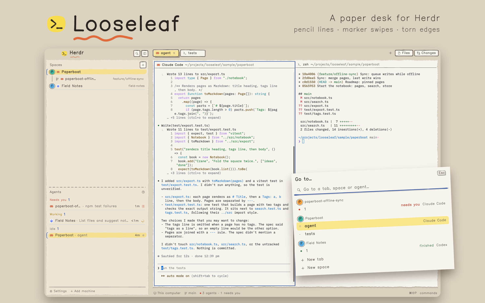
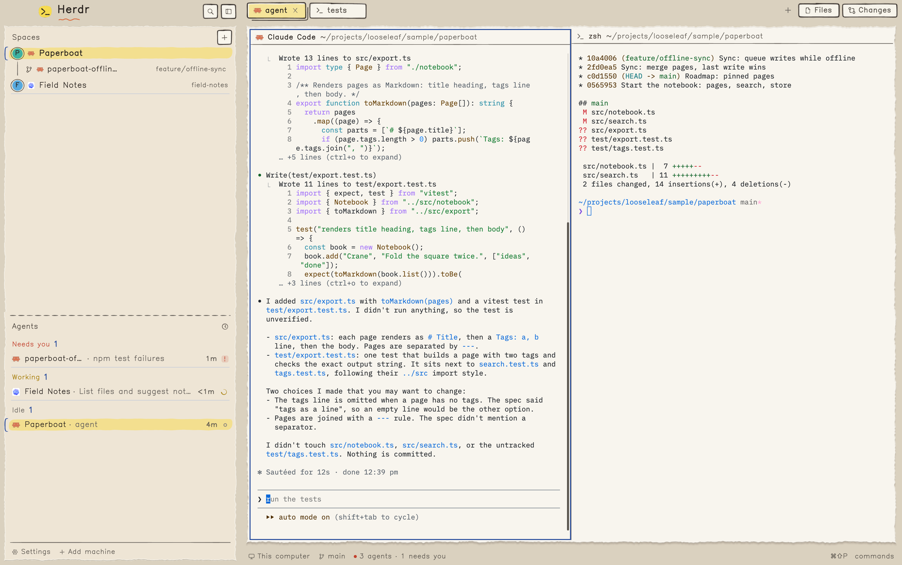
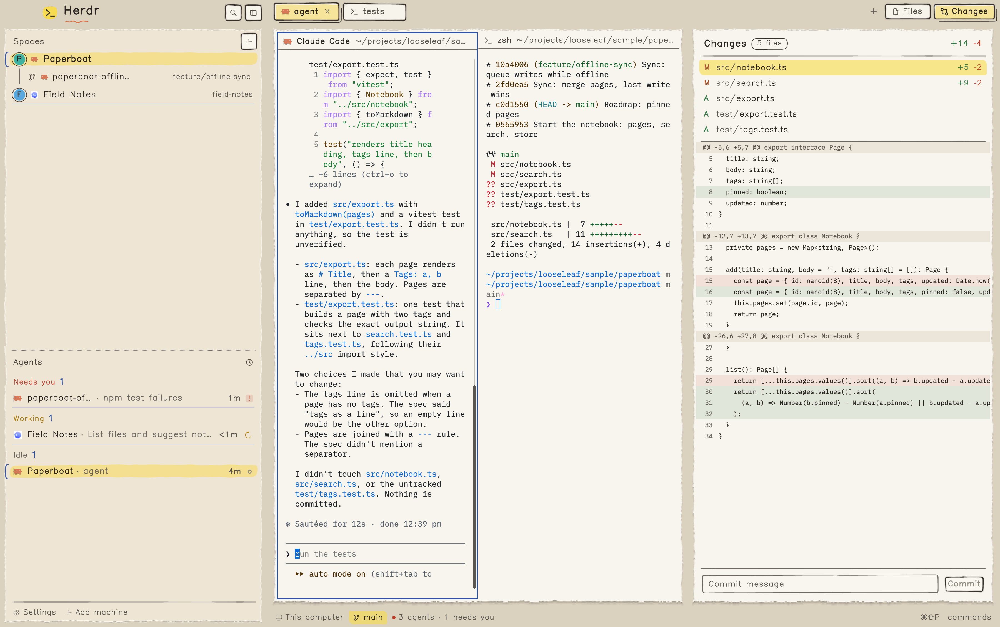
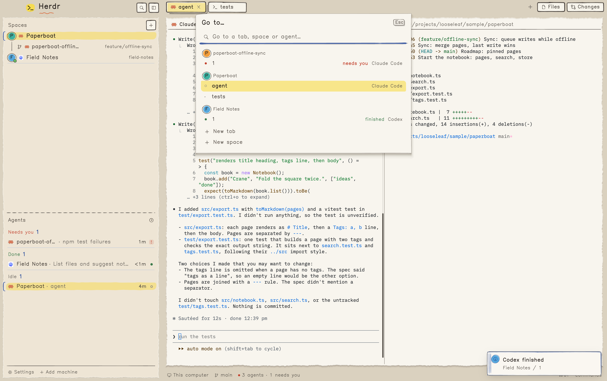
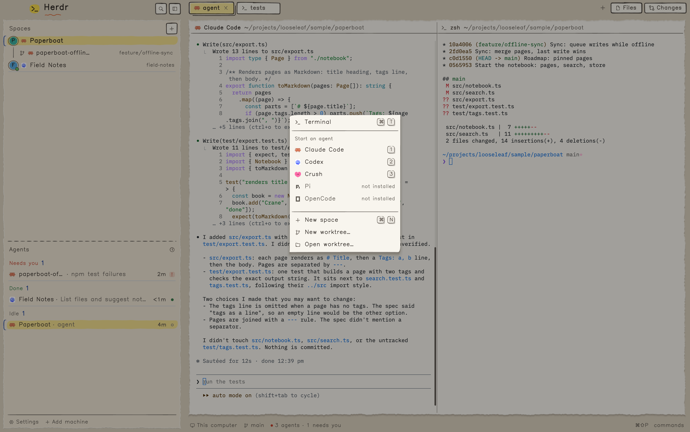
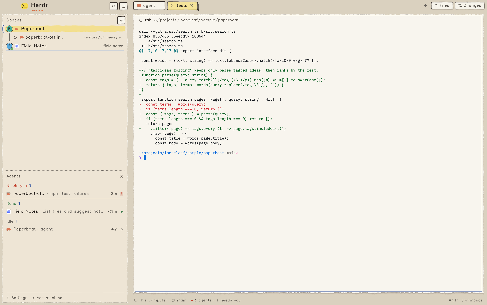
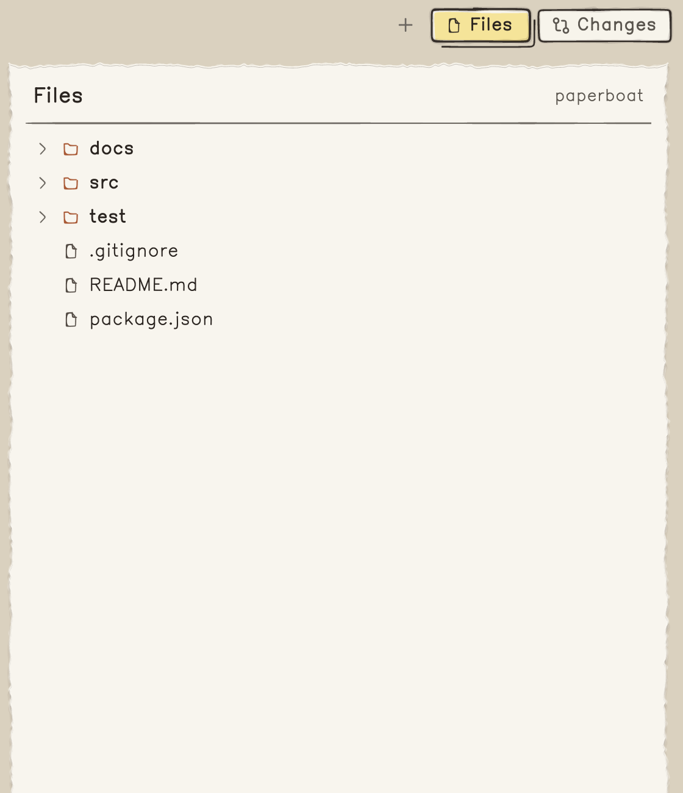

# Looseleaf for Herdr

A [Herdr](https://herdr.dev) layout that turns the terminal workspace into a paper desk: terminals sit on torn-edge pages, the sidebar is a sheet of parchment with ruled rows, buttons are inked slips, and the selected thing gets a highlighter swipe.

Every drawn part comes from [Looseleaf](https://kevintngo.github.io/looseleaf), Kevin Ngo's hand-drawn component library. Herdr mods can't use CSS or the DOM, so each component was drawn once by Looseleaf's own ink engine and saved as SVG art that the mods place and crop.



## Screenshots

| | |
|---|---|
|  The workspace: two panes on one page, the focused one outlined in blue ink |  The Changes panel with a diff and the commit field |
|  The "Go to…" picker (`cmd-p`) and a toast |  The + menu: a terminal, the agents you can start, spaces and worktrees |
|  Code colours follow GitHub Light |  The Files panel |

Close-ups: [sidebar](screenshots/sidebar.png), [tabs and pane headers](screenshots/tabs.png), [toast](screenshots/toast.png).

## Looseleaf components used

| Looseleaf component | Where it shows up in Herdr |
|---|---|
| [Paper](https://kevintngo.github.io/looseleaf/#/components/paper) | The terminal page and side panel (paper stock, deckled edge, soft shadow), the sidebar (parchment stock), every menu, the picker and tooltips |
| [Sidebar](https://kevintngo.github.io/looseleaf/#/components/sidebar) | Group labels, ruled menu rows, worktrees hanging on a pencil rule, blue-ink counts |
| [Button](https://kevintngo.github.io/looseleaf/#/components/button) | Outline buttons (Files, Changes, Commit), outline icon buttons (search, sidebar toggle, new space), ghost buttons (status bar, Settings, Add machine) |
| [Tabs](https://kevintngo.github.io/looseleaf/#/components/tabs) | Terminal tabs as outline slips; the open tab takes the highlighter wash and a pen drop line |
| [Button Group](https://kevintngo.github.io/looseleaf/#/components/button-group) | Files and Changes, side by side in the top bar |
| [Avatar](https://kevintngo.github.io/looseleaf/#/components/avatar) | A marker-filled disc with an ink ring for each space, and a status dot (busy when an agent needs you, online when one finished) |
| [Badge](https://kevintngo.github.io/looseleaf/#/components/badge) | "N files" (outline) and "Needs you" (destructive) |
| [Alert](https://kevintngo.github.io/looseleaf/#/components/alert) | Toasts, one drawn slip per tone: default, info, success, warning, destructive |
| [Dropdown Menu](https://kevintngo.github.io/looseleaf/#/components/dropdown-menu) / [Context Menu](https://kevintngo.github.io/looseleaf/#/components/context-menu) | The + menu and the right-click menus for tabs, spaces and terminals |
| [Command](https://kevintngo.github.io/looseleaf/#/components/command) | The "Go to…" picker: the input on a rule that turns blue when focused |
| [Input](https://kevintngo.github.io/looseleaf/#/components/input) | The commit message field |
| [Kbd](https://kevintngo.github.io/looseleaf/#/components/kbd) | Shortcut keycaps in menus and the picker |
| [Separator](https://kevintngo.github.io/looseleaf/#/components/separator) | Pencil rules under headers and between sections, and the dashed rule above Agents |
| [Tooltip](https://kevintngo.github.io/looseleaf/#/components/tooltip) | The slip that shows a cut-off space, worktree or branch name in full |
| [Highlight](https://kevintngo.github.io/looseleaf/#/components/highlight) | The yellow swipe on the selected row and on hover |
| [Icon](https://kevintngo.github.io/looseleaf/#/components/icon) | Every interface icon, drawn by Looseleaf's icon set |
| [Squiggle](https://kevintngo.github.io/looseleaf/#/components/squiggle) / [Doodle](https://kevintngo.github.io/looseleaf/#/components/doodle) | The underline beneath "Herdr" and the `>_` mark on its marker blob |
| [Typography](https://kevintngo.github.io/looseleaf/#/components/typography) | Kevin Sans for the whole interface |

Also taken from Looseleaf's tokens: ink `#2a2420`, pencil `#8e887f`, highlighter `#f8dc4c`, focus blue `#2c4f9e`, paper `#f8f5ee`, pad rule `#b2c3dc`.

## Install

Ask your agent in Herdr:

> Add the layout at github.com/iampedii/looseleaf

or do it by hand:

1. Copy `layouts/looseleaf.json` and `layouts/looseleaf.svg` to `~/.config/herdr-app/layouts/`, `themes/looseleaf.json` to `~/.config/herdr-app/themes/`, and every folder in `mods/` to `~/.config/herdr-app/mods/`.
2. Fonts need no install: Kevin Sans (interface) and IBM Plex Mono (terminal) ship in `mods/looseleaf-chrome/fonts/` and Herdr loads them from there.
3. Optional: merge `keys.json` into yours so `cmd-p` opens the Looseleaf picker instead of the stock one.
4. Switch with `cmd-shift-l`, or run `herdr-app do layout.switch --name looseleaf`.

Built and checked on Herdr 0.1.15, macOS. It is a light theme only.

What the mods do on your machine: `looseleaf-spaces`, `looseleaf-changes`, `looseleaf-files` and `looseleaf-menu` run `git` (read-only, plus commit from the Changes panel) in your space folders; `looseleaf-spaces` and `looseleaf-picker` call `hc machine ls`. Nothing reaches the network.

## What's in here

```
layouts/looseleaf.json   the layout tree          layouts/looseleaf.svg   its picture in the layout switcher
themes/looseleaf.json    paper colours, GitHub Light ANSI
mods/looseleaf-*         13 mods (below)
keys.json                the one key it wants
RECIPE.md                the brief to rebuild it from scratch
tools/                   scripts that draw the art with Looseleaf's ink engine
sample/make.sh           builds the sample projects used in the screenshots
```

| Mod | Draws |
|---|---|
| `looseleaf-chrome` | The brand strip and the sidebar foot; also holds the shared art (`ink/`), icons and fonts |
| `looseleaf-spaces` | Spaces with avatars, agent icons, worktrees, git ahead/behind, hover tooltips |
| `looseleaf-agents` | Agents grouped by status, with a sort menu |
| `looseleaf-tabs` | Tabs, the + button, Files and Changes |
| `looseleaf-pane` | Each terminal's header |
| `looseleaf-edge` | One torn edge of a page; eight copies frame the terminals and the side panel |
| `looseleaf-changes`, `looseleaf-files` | The side panel |
| `looseleaf-picker` | "Go to…" |
| `looseleaf-menu`, `looseleaf-new-menu` | Right-click menus and the + menu |
| `looseleaf-toast` | Notifications |
| `looseleaf-workspace-status` | The status bar |

## Redrawing the art

The SVGs in `mods/*/ink/` are drawn by Looseleaf's recipes, not by hand. To change a size or add a width:

```sh
git clone https://github.com/kevintngo/looseleaf && cd looseleaf && npm install
cp /path/to/this/repo/tools/*.ts tools/
npx tsx --tsconfig tsconfig.json tools/herdr-ink.ts jobs.json     # buttons, badges, fields, rows, keycaps
npx tsx --tsconfig tsconfig.json tools/herdr-paper.ts jobs.json   # paper sheets
```

A job is `{ "recipe": "button", "params": { "variant": "outline", "size": "sm" }, "w": 132, "h": 26, "layers": ["rest"], "out": "pb-132.svg" }` for `herdr-ink.ts`, or `{ "stock": "paper", "w": 640, "h": 1600, "out": "sheet-640.svg" }` for `herdr-paper.ts`. `RECIPE.md` lists every asset and its sizes.

## Known limits

- The line between split panes and the blue focus outline are straight; Herdr draws those itself.
- The command palette (`cmd-shift-p`), Settings, and the worktree and add-machine dialogs keep Herdr's shape with the paper colours.
- The page edges cover windows up to about 3200 × 1790 points.
- On the collapsed sidebar rail, the page's right edge is cut straight.

## Credits and licence

- [Looseleaf](https://github.com/kevintngo/looseleaf) by Kevin Ngo and contributors, MIT: the design, the ink engine that drew the art, the icons and Kevin Sans. Its licence is in `LICENSE-looseleaf`.
- [IBM Plex Mono](https://github.com/IBM/plex), SIL Open Font License; the licence sits beside the font.
- The mods started as copies of Herdr's shipped mods (`spaces`, `agents`, `tabs`, `pane`, `picker`, `changes`, `files`, `toast`, `workspace-chrome`, `workspace-status`).
- Terminal colours follow GitHub Light.

This repository is MIT licensed; see `LICENSE`.
