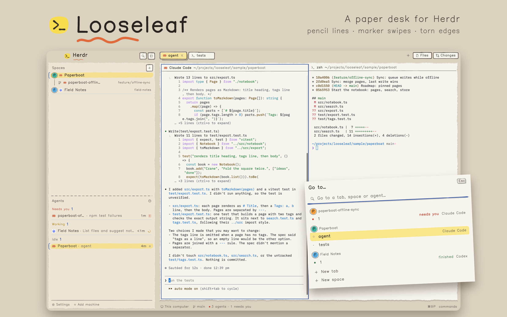

# Looseleaf

A paper desk. The window is a flat warm-cream desk with three sheets on it: a parchment sidebar on the left listing spaces and agents, a white page holding the terminals, and (when opened) a second white page on the right for Files or Changes. Pages have torn, deckled edges and a soft shadow. Buttons are small inked slips, the selected row carries a yellow highlighter swipe, lines are pencil, the focused terminal is outlined in blue ink, and all interface text is in the hand-lettered Kevin Sans. Light only. The look is [Looseleaf](https://kevintngo.github.io/looseleaf) by Kevin Ngo; every drawn part is one of its components, rendered to SVG by its ink engine.



## What you see

Left to right, top to bottom.

**Desk.** Flat `#dad1bf` behind everything. No titlebar; macOS traffic lights at 12,16.

**Sidebar column** (268 px, resizable; under 160 px it becomes an icon rail).

- Brand strip, 46 px, on the desk: a 32 px `>_` mark (ink on a highlighter-yellow marker blob), "Herdr" in Kevin Sans Bold 20 px `#2a2420`, a 46×6 px orange squiggle under it; right-aligned, two 28 px outline icon buttons (search, sidebar toggle) 8 px apart.
- One parchment sheet runs from below the brand strip to the bottom, 8 px in from the sidebar's sides: three blocks each draw their part of the same tall drawing (top edge and sides, sides only, sides and bottom edge) so it reads as one page.
  - Spaces: a label "Spaces" 13.5 px `#4a433c` with a 28 px outline icon button (+) on its right. Rows 30 px: a 22 px avatar (marker-filled disc in the space's colour, ink ring, the name's first letter, a 9 px status dot bottom-right), then one 14 px icon per agent program running there (with a count when more than one), the name at 14.5 px, and right-aligned pencil-grey 12 px text for the repo and branch when unusual, `↑n` green `#3b7a4b` and `↓n` red `#c2412d`. Each row sits on a 1 px `#b2c3dc` ruled line. The open space is bold with a highlighter swipe and a blue bracket at its left. Worktrees are 28 px rows hanging off a vertical pencil rule, with a branch glyph.
  - A dashed pencil rule, then Agents: label 13.5 px with a sort button; groups "Needs you" (red), "Working" (amber), "Done" (green), "Idle" (grey), 12.5 px labels with a bold blue `#2c4f9e` count; rows show the program icon, space and tab, the task text in pencil, age, and a status glyph.
  - Foot, 46 px: a pencil rule, then two ghost buttons "Settings" and "Add machine" (12.5 px, 14 px icons).

**Work column.**

- Tabs strip, 42 px, on the desk: each tab is an outline slip 26 px high (program icon, name, close ×); the open one has the highlighter wash and a pen drop line. Then a ghost "+", and at the right a pair of outline buttons, "Files" and "Changes" (13.2 px bold, 16 px icons), lit when their panel is open.
- The page: a white `#f8f5ee` sheet with deckled edges on all four sides (12 px edge strips) and a soft warm shadow. Inside, the tab's panes. Each pane has a 30 px header: program icon 16 px, program name bold 13 px, folder in pencil, ghost icon buttons (split right, split down, zoom, close) on the focused pane, and a drawn pencil rule along its bottom. Split panes are separated by a 1 px `#8e887f` line. The focused pane has a 2 px `#2c4f9e` outline. Terminal text is IBM Plex Mono 14 px, padding 14/12, GitHub Light colours.
- Side panel (hidden until asked for; 368 px, 280 to 900): the same deckled page. Changes: "Changes" 15.5 px bold, an outline badge "N files", `+n` green and `-n` red totals, a pencil rule, the file list (M/A/D letter, path, per-file counts; the open file swiped), the diff (added lines tinted green, removed red, hunk headers shaded), and at the bottom a drawn input "Commit message" and an outline "Commit" button. Files: "Files" title, the folder name at right, a tree with bold folders (rust-brown folder icons) and plain files.
- Status bar, 34 px, on the desk: ghost buttons for the machine, the branch (toggles Changes), "N agents · N needs you" with a status dot, and at the right the palette key and "commands".

**Overlays**, all on Paper with a firmer pencil edge and a lifted shadow, no Herdr frame:

- "Go to…" picker: 672 px wide popup at the top. Title 17 px bold, an Esc keycap, a search input on a blue brush rule, then spaces (avatar and name) with their tabs under them (status dot, name, status word, program), then "New tab" and "New space".
- + menu (318 px): "Terminal" with its shortcut keycaps, a pencil separator, the label "Start an agent", installed agents with number keycaps, two not-installed ones in pencil, a separator, "New space", "New worktree…", "Open worktree…".
- Right-click menus for a tab, a space and a terminal (268 to 278 px): rows 32 px, 16 px icons, 14 px text, the hovered row swiped, destructive rows in red.
- Tooltip: a 28 px slip with the full text of a cut-off name.
- Toast, bottom right: a drawn alert slip with a double rule at its left in the tone's ink, a round icon, a bold title and a pencil body.

## How it behaves

- Agent status: blocked shows in "Needs you" with a red `!` badge, a red dot in the status bar and a busy (red) dot on the space's avatar. Working shows a spinning arc. Done shows a green dot or check, and the avatar dot goes green. Idle shows a hollow grey dot.
- Click a space to open it; drag to reorder inside its machine; right-click for its menu. Click + to make a space.
- Click an agent row to focus its pane; the sort button opens a menu (Priority, or Grouped by space).
- Click a tab to show it, drag to reorder, double-click to rename, × to close, right-click for its menu. Scrolling over the strip moves between tabs.
- Files and Changes toggle the side panel on that view; the branch in the status bar toggles Changes.
- `cmd-p` (from `keys.json`) or the search button opens the picker: type to filter, arrows and Enter to go, Esc to close.
- In the + menu, digits 1 to 9 start that agent.
- Hover: rows and ghost buttons take a soft highlighter swipe; outline buttons switch to their highlighter drawing; a cut-off space, worktree or branch name shows its tooltip after 350 ms.
- The sidebar toggle shrinks the sidebar to a rail (76 px on macOS, 44 elsewhere) and back to its last width.

## Built from

**Layout tree** (`layouts/looseleaf.json`): root row, `background "#dad1bf"`, `theme "looseleaf"`, `font "IBM Plex Mono"` 14, `ui_font "Kevin Sans"`, `terminal_padding [14,12]`, `titlebar "none"`, `toast "looseleaf-toast"`, `terminal_menu "looseleaf-menu"`.

```
sidebar (column, 268px)
  brand            looseleaf-chrome                 46px
  sidebar-lists (column)
    spaces         looseleaf-spaces                 weight 1
    agents         looseleaf-agents                 weight 1
  sidebar-footer   looseleaf-chrome {footer:true}   46px
work (column)
  tabs             looseleaf-tabs                   42px
  work-body (row, padding [4,6], gap 6)
    page (column)
      page-top     looseleaf-edge {side:"top"}      12px
      page-row (row): page-left 12px | main (tab block) | page-right 12px
      page-bottom  looseleaf-edge {side:"bottom"}   12px
    panel (column, 368px, min 280, max 900, hidden)
      panel-top / panel-row (panel-left | panel-body stack: files, changes | panel-right) / panel-bottom
  status           looseleaf-workspace-status       34px
```

`main`: `background "#8e887f"` (shows through the 1 px pane gap as the divider); pane `header {mod: looseleaf-pane, height 30, top, reveal always}`, `background "background"`, `border {width 0}`, `focus {width 2, color "#2c4f9e"}`, `radius 0`, `gap 1`, `lone true`.

**Theme** (`themes/looseleaf.json`): background `#f8f5ee`, foreground `#1f2328`, GitHub Light ANSI; colours canvas `#dad1bf`, border `#8e887f`, selected `#f8e68a`, accent `#2c4f9e`, foreground `#2a2420`, muted `#5a554e`, working `#a87f0c`, blocked `#c2412d`, done `#3b7a4b`, idle `#8e887f`.

**Mods.** Ten are clones of shipped mods, restyled: `looseleaf-spaces` (spaces), `-agents` (agents), `-tabs` (tabs), `-pane` (pane), `-picker` (picker), `-changes` (changes), `-files` (files), `-toast` (toast), `-chrome` (workspace-chrome; `props.footer` picks the foot), `-workspace-status`. Three are new: `looseleaf-edge` (`props.side`: top, bottom, left, right), `looseleaf-menu` (`props.tab`: tab, space, or the terminal menu; `props.target`), `looseleaf-new-menu`. Shipped mods still used: `worktree`, `machine-add`.

**Herdr calls.** `spaces`, `agents`, `panes`, `terminals`, `machines`, `focused`, `layout`, `theme`, `keys`, `settings`, `window`, `updates`, `knownAgents`, `shared`/`setShared` (`space.colors`, `sidebar.width`, `workspace.panels`), `openOverlay`/`closeOverlay`, `watchFolder`, `readTextFile`, `exec` (git only), `hc machine ls`. Commands: `space.new/select/move`, `tab.new/select/close/move/rename`, `pane.focus`, `agent.next`, `terminal.peek/pin`, `layout.show/hide/select/resize`, `mod.open`, `app.settings`, `app.palette`, `window.close/minimize/maximize`. `HoverCard` from `gpui-base` carries the tooltips.

**Art.** Drawn by Looseleaf's ink engine with the scripts in `tools/`, CSS variables resolved to hex, page-only masks dropped, each saved with its padding so the image is placed at `left(-pad) top(-pad)`:

- `looseleaf-chrome/ink/`: `parchment-<w>.svg` (parchment stock, 100 to 480 step 4, 1600 tall, pad 5); `pop-<w>.svg` (paper with lifted shadow; 220, 230, 240, 250, 290, 640; pad 16); `row-<w>-<h>.svg` (the active row's swipe and bracket, h 28 and 30); `badge-{o,d,s}-<w>.svg` (h 20, 28 to 120 step 4); `field-<w>(-on).svg` (h 32, 120 to 780 step 4); `key-<w>.svg` (keycaps, 20 to 64 step 2); `ib-{a,b,c}(-on).svg` (28 px outline icon button); `av-<tone>.svg`, `av-ring.svg`, `av-dot-<status>.svg`; `rule-h.svg`, `rule-v.svg` (one long pencil line each, cropped to fit); `sep-dashed.svg`; `cmd-616-on.svg`.
- `looseleaf-tabs/ink/`: `tab-<w>(-on).svg` and `pb-<w>(-on).svg` (outline button `sm`, h 26, step 4).
- `looseleaf-edge/ink/`: eight slices of one 4000×2400 deckled paper sheet (`top-l`, `top-r`, `bottom-l`, `bottom-r`, `left-t`, `left-b`, `right-t`, `right-b`) with the lighting removed, a stacked soft shadow in `#3a2c1e` and the outline at 0.26 opacity.
- `looseleaf-toast/ink/alert-<tone>.svg`; icons in `looseleaf-chrome/*.svg` and beside the mods that use them; `looseleaf-chrome/mark.svg` and `squiggle.svg`.

Variable sizes use crops of one tall or long drawing: the top and sides from its top, the bottom edge from its bottom (and for the tooltip, four corner crops).

## Watch out

- Herdr will not let a mod draw on a terminal: a pane header is clipped to its strip, and a pane background is painted over. The torn edges are four thin sibling blocks around the tab block, not pane borders.
- Overlays clip to their bounds, so a paper's shadow needs padding inside the overlay; the overlay sizes are 28 px wider and 26 px taller than the sheet.
- SVG blur filters do not render; soft shadows are stacked translucent offset copies.
- Colours in SVG must be hex or comma `rgb()`; the space-separated form fails.
- Shipped mods are read-only: clone them and point the layout at the clones.
- GPUI has no letter-spacing or rotation, and Kevin Sans's script variant is the same file, so all text is one face.
- Width-bucketed art needs the element's measured width (`on_size_change`), rounded to the bucket step.
- The edge slices cover about 3206 × 1794 px; larger windows run out of drawing.
- The line between split panes and the focus outline are Herdr's and stay straight.
- Tooltips appear by name length (over 17 characters for a space, 15 for a worktree), not by measured truncation, and their width is estimated from the text.
- The command palette, Settings, confirm and prompt, and the `worktree` and `machine-add` dialogs are Herdr's own, coloured by the theme only.
- The fonts (Kevin Sans Regular and Bold, IBM Plex Mono Regular) ship in `looseleaf-chrome/fonts/`, where Herdr loads them; without that folder the text falls back to the defaults.
- Assumes `git` on the path.

## Done when

- `herdr-app check mods/<name>` passes for all 13 mods and `herdr-app status` shows `"errors": []` after `layout.switch {name: "looseleaf"}`.
- The terminals sit on one page with a torn edge on all four sides at any window size, and the side panel has the same frame when shown.
- A space with a running agent shows that program's icon before its name; a blocked agent appears under "Needs you" and turns its space's avatar dot red.
- Files and Changes open and close the side panel; Changes lists modified and untracked files with a coloured diff.
- `cmd-p` opens "Go to…" on Paper, typing filters it, Enter goes there.
- Right-clicking a tab, a space and a terminal each opens a Paper menu whose shadow is not clipped.
- The + menu lists installed agents and digits start them.
- Resting the pointer on a cut-off space name shows the full name on a slip.
